# Anzhelika Spekter | Business Automation Specialist

<picture>
  <source media="(prefers-color-scheme: dark)" srcset="dark.svg">
  <source media="(prefers-color-scheme: light)" srcset="light.svg">
  
</picture>

---

### I am a **Business Automation Specialist** focused on designing custom automated workflows, integrating AI services, connecting business systems, and building interactive applications. I bridge the gap between business process logic and technical implementation, helping digital professionals, content teams, and micro- and small-businesses streamline operations.

<picture>
  <source media="(prefers-color-scheme: dark)" srcset="./principles-dark.svg">
  <source media="(prefers-color-scheme: light)" srcset="./principles-light.svg">
  
</picture>

---

## 🧰 Tech Stack & Arsenal

### Automation & Integration

### CRM & Business Workflows

### AI & Intelligent Processing

### Data, SQL & Reporting

### 📱 Social Platforms & Messaging

### UI/UX, Dashboards & Mini Apps

### Frontend & TMA Development

### Infrastructure & Databases

---

### 📫 **How to reach me:** 

#### Feel free to open an issue or connect with me if you need to structure your workflow logic and deploy tailored automation solutions.

---

<!--

-->

